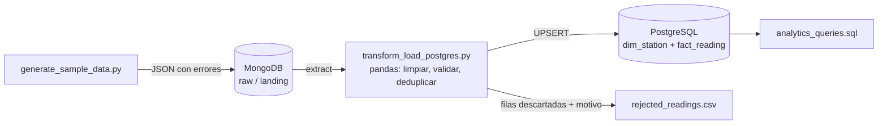

# urban-mobility-etl

Pipeline ETL de práctica para datos sintéticos de **calidad del aire y tráfico urbano**:
ingesta en MongoDB (zona raw), limpieza y validación con pandas, carga idempotente en
PostgreSQL (UPSERT) y consultas analíticas en SQL.

> Proyecto personal con **datos sintéticos** generados por el propio repositorio. Su objetivo es
> demostrar fundamentos de ingeniería de datos, no representar una solución en producción.

## Arquitectura



## Stack
Python 3.10+, pandas, pymongo, psycopg2, MongoDB 7, PostgreSQL 16, Docker Compose, pytest.

## Estructura
```
src/        generate_sample_data.py · extract_load_mongo.py · transform_load_postgres.py · config.py
sql/        schema.sql · analytics_queries.sql
tests/      test_transform.py
```

## Cómo ejecutarlo

```bash
# 1. Entorno
python -m venv .venv && source .venv/bin/activate      # Windows: .venv\Scripts\activate
pip install -r requirements.txt
cp .env.example .env

# 2. Bases de datos locales
docker compose up -d        # espera unos segundos a que arranquen

# 3. Pipeline
python -m src.generate_sample_data      # crea data/raw/air_traffic_readings.json
python -m src.extract_load_mongo        # JSON -> MongoDB (raw)
python -m src.transform_load_postgres   # MongoDB -> limpieza -> PostgreSQL

# 4. Consultas analíticas
docker compose exec -T postgres psql -U postgres -d urban_mobility < sql/analytics_queries.sql
```

## Cómo probarlo

**Tests unitarios de limpieza**
```bash
pytest
```

**Idempotencia** (ejecutar dos veces no duplica datos)
```bash
python -m src.extract_load_mongo        # 2ª vez: "Nuevos: 0"
python -m src.transform_load_postgres   # 2ª vez: inserted=0, updated=0, unchanged=N
docker compose exec mongo mongosh urban_mobility --eval "db.raw_readings.countDocuments()"
docker compose exec postgres psql -U postgres -d urban_mobility -c "SELECT COUNT(*) FROM fact_reading;"
```

## Reglas de calidad de datos

| Problema | Tratamiento |
|---|---|
| Fechas en 3 formatos | Parseo estricto por formato; si ninguno encaja -> fila rechazada |
| Fecha imposible (31/02) | Fila rechazada (`fecha inválida`) |
| Nulos disfrazados (`""`, `N/A`, `null`) | Convertidos a NULL |
| Decimales con coma (`"23,4"`) | Convertidos a número |
| Valores negativos / atípicos | Se anula el valor (NULL), se conserva la fila |
| Sin `station_id` o sin ninguna medida | Fila rechazada, guardada en `data/processed/rejected_readings.csv` |
| Duplicados (exactos y con otro formato) | Dedup por `(station_id, measured_at)`; se conserva la fila más completa |
| Nombres de estación inconsistentes | Gana el valor más frecuente por estación |

## Decisiones de diseño
- **MongoDB como raw**: guarda el dato tal cual llega, con trazabilidad (`_meta`), y permite reprocesar.
- **Ingesta idempotente**: `_id` determinista (huella del fichero + nº de fila) y `upsert`.
- **UPSERT en Postgres** con `ON CONFLICT DO UPDATE` y actualización solo si hay cambios.
- **Transacción única** en la carga: o entra todo o nada.
- **Modelo en estrella mínimo**: `dim_station` + `fact_reading`.
- Las fechas se asumen en **hora local sin zona horaria** (supuesto documentado).

## Limitaciones y siguientes pasos
- Datos sintéticos y volumen pequeño (miles de filas), pensados para aprender y demostrar.
- Ejecución manual: el siguiente paso sería orquestarlo con Airflow o similar.
- Carga completa en memoria con pandas: para volúmenes grandes habría que procesar por bloques.
- Posibles mejoras: tests de integración, logging a fichero, validación con Great Expectations o pandera, CI con GitHub Actions.